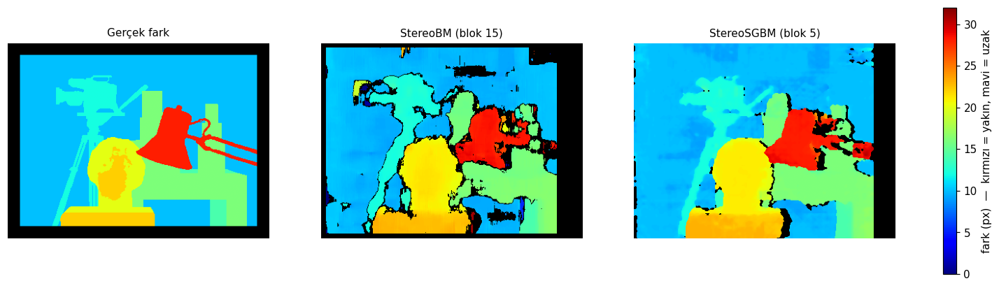
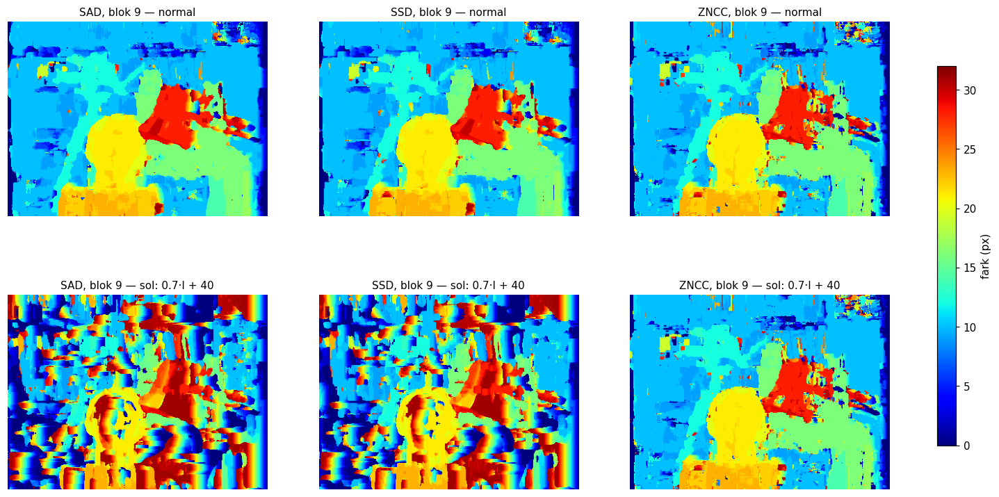
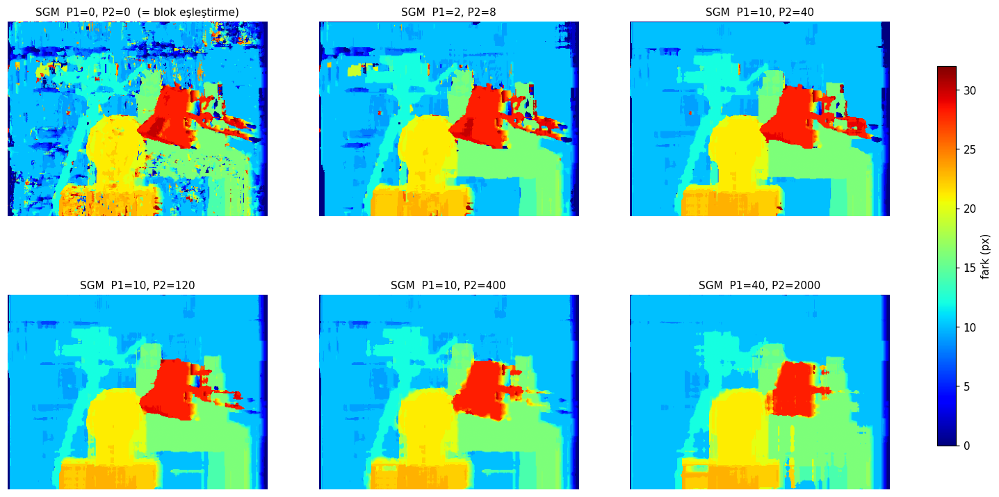
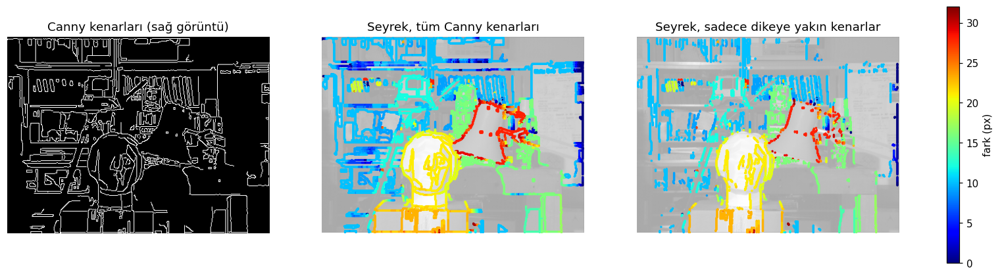

# Digital Image Processing — Week 10: Stereo Matching

**Group members: Nmertgules and Iliya**

Middlebury 2001 **Tsukuba** sahnesinin 1. ve 3. görüntüsü (`scene1.row3.col1`, `scene1.row3.col3`) ile fark haritası (disparity map): OpenCV StereoBM/StereoSGBM, kendi blok eşleştirme fonksiyonumuz, SAD/SSD/ZNCC karşılaştırması, kendi yazdığımız Semi-Global Matching ve ev ödevi olarak kenar tabanlı seyrek stereo.

## Dosyalar

| Dosya | İçerik |
| --- | --- |
| [stereo_odev.ipynb](stereo_odev.ipynb) · [Colab](https://colab.research.google.com/github/iliyadindar/DEEP/blob/main/week10/stereo_odev.ipynb) | Bütün görevler; açıklamalar Türkçe, çıktılarıyla kaydedildi |
| [stereo_odev.html](stereo_odev.html) | Notebook'un HTML çıktısı (`jupyter nbconvert --to html`) |
| [assets/](assets/) | `tsukuba.zip` içinden col1, col3 ve col3 için gerçek fark haritası (PNG) |
| [results/](results/) | Notebook'un kaydettiği şekiller |

## Görevler

| Görev | Yapılan işlem |
| --- | --- |
| 1 | `StereoBM` (blok 15) ve `StereoSGBM` (blok 5) ile fark haritası; renklerin anlamı ve haritanın neden tek başına gerçek derinlik vermediği ($Z = fB/d$, kalibrasyon gerekir) |
| 2 | StereoBM kullanmadan kendi blok eşleştirme fonksiyonumuz: her `d` için kaydırma + integral görüntüyle pencere toplamı + argmin; blok 5 / 9 / 15 |
| 3 | Aynı imzalı SAD, SSD ve ZNCC maliyet fonksiyonları, `blok_eslestir`'e parametre olarak verilir (C++'taki fonksiyon pointer'ının karşılığı); normal çiftte ve parlaklığı değiştirilmiş çiftte test, avantaj/dezavantaj tablosu |
| 4 | Semi-Global Matching'i (ödevde "SGBC") kendimiz yazdık: 4 yönlü dinamik programlama, P1/P2 cezaları; yumuşaklık parametresinin etkisi 6 ayarla gösterildi |
| Ev ödevi | Canny kenarlarında seyrek stereo (dikeye yakın kenarlar ayrıca); yoğun yöntemlerle hız ve doğruluk karşılaştırması |

**Referans görüntü:** gerçek fark haritası col3 için verildiği için bütün haritalar col3 koordinatlarında hesaplandı (OpenCV'ye görüntüler aynalanıp yer değiştirilerek verilir). col1–col3 arasında iki kamera adımı olduğu için gerçek fark `truedisp / 16 * 2` = 10–28 px.

**Ölçüt:** kötü piksel % = gerçek farkı bilinen piksellerden hatası 2 px'den büyük olanların veya değer üretilmeyenlerin oranı.

## Sonuçlar

| Yöntem | Kötü piksel % | MAE (px) | Süre |
| --- | --- | --- | --- |
| OpenCV StereoBM (blok 15) | 23,5 | 0,85 | ~2 ms |
| OpenCV StereoSGBM (blok 5) | 12,3 | 0,74 | ~8 ms |
| Kendi BM, SAD (blok 5 / 9 / 15) | 19,5 / 14,4 / 12,5 | 2,00 / 1,57 / 1,41 | ~100 ms |
| Kendi BM, ZNCC (blok 9) | 15,8 | 1,81 | ~320 ms |
| Kendi SGM, SAD 5 × 5, P1 = 10, P2 = 120 | **7,8** | 0,92 | ~210 ms |

OpenCV'nin kötü piksel oranının büyük kısmı, emin olmadığı pikselleri atmasından geliyor (kapsama BM %82, SGBM %92). Değer ürettiği piksellerde alt-piksel hassasiyeti sayesinde MAE'si daha düşük.

**SAD / SSD / ZNCC (blok 9):** normal çiftte kötü piksel %14,4 / %15,9 / %15,8. Sol görüntü `0.7·I + 40` yapılınca SAD %61,9'a, SSD %55,6'ya çıkıyor, ZNCC %15,9'da kalıyor: ZNCC doğrusal parlaklık değişimine karşı değişmez ama ~3 kat yavaş.

**Yumuşaklık (P1, P2):** ceza yoksa (0, 0) SGM blok eşleştirmeyle aynı (%19,5). (10, 40)–(10, 120) arası en iyi (%7,5–7,8). (40, 2000)'de ince lamba kolu kayboluyor ve çizgi artefaktları çıkıyor (%12,8).

**Seyrek stereo:** Canny piksellerin %10,8'ini, dikeye yakın kenarlar %5,5'ini veriyor. Aynı kodla (doğrudan 9 × 9 SAD) bütün görüntüye göre ~10 ve ~20 kat hızlı. Integral görüntülü yoğun BM ise aynı sürede bütün görüntüyü bitiriyor. Aynı piksellerde doğruluk yoğun BM ile birebir aynı (%14,9), dikey kenarlarda %11,0; SGM bu piksellerde de daha iyi (%8,1 / %7,1). Seyrek yöntemin bedeli kapsama: dokusuz yüzeylerde hiç değer yok.

## Çalıştırma

**Colab:** yukarıdaki Colab bağlantısını açıp *Çalışma zamanı → Tümünü çalıştır* (GPU gerekmez). Görüntüler `assets/` içinde yoksa notebook `tsukuba.zip`'i Middlebury'den kendisi indirir.

**Kendi bilgisayarınızda:** `pip install -r week10/requirements.txt`, sonra notebook `week10` klasöründen (veya repo kökünden) çalıştırılır. Şekiller `week10/results/` altına yazılır.

Kaydedilen çıktılar Windows 11 üzerinde Python 3.14, NumPy 2.3, OpenCV 4.13 ve Matplotlib 3.10 ile üretildi. Rastgelelik yok; doğruluk sayıları her çalıştırmada aynı, süreler makineye ve çalıştırmaya göre değişir.
