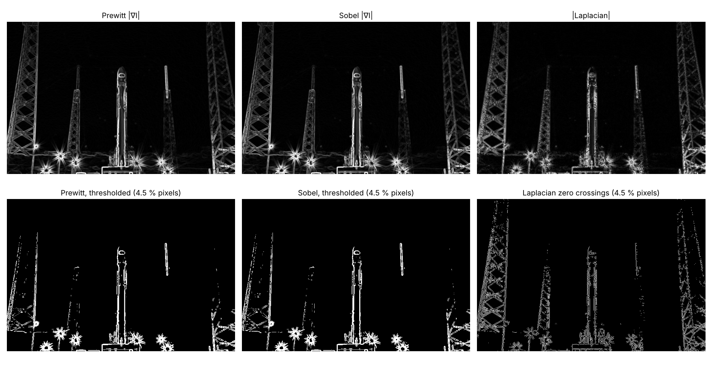

# Laplacian, Sobel ve Prewitt ile Kenar Tespitinin Karşılaştırılması

**Grup: Nmertgules ve Iliya** · Hafta 4, Görev 5 · Ölçümler: [05_laplacian_gauss.ipynb](05_laplacian_gauss.ipynb) · Sobel/Prewitt karşılaştırması: [SOBEL_VS_PREWITT.md](SOBEL_VS_PREWITT.md)

## Yöntem

Tüm operatörler aynı gri görüntüye (640×427) aynı hafif Gauss filtresinden (5×5, σ = 1) sonra uygulanmıştır.

```
Laplacian (4-komşu)    Laplacian (8-komşu)    Sobel-x        Prewitt-x
[0  1  0]              [1  1  1]              [-1 0 1]       [-1 0 1]
[1 -4  1]              [1 -8  1]              [-2 0 2]       [-1 0 1]
[0  1  0]              [1  1  1]              [-1 0 1]       [-1 0 1]
```

**Temel fark:** Sobel ve Prewitt **birinci türevi** (gradyanı) hesaplar. Her biri bir x ve bir y kerneli kullanır. Kenar, gradyan büyüklüğü `√(Gx² + Gy²)` haritasında bir **tepe** olarak görülür ve bir eşikle seçilir. Laplacian ise iki yöndeki **ikinci türevin toplamıdır** (∇²I = ∂²I/∂x² + ∂²I/∂y²) ve tek bir kernel kullanır. Kenar noktasında değer **sıfırdan geçer**: koyu tarafta pozitif, açık tarafta negatiftir. Bu yüzden kenarlar sıfır geçişlerinden bulunur. Bir piksel, sağ ya da alt komşusuyla işaret değiştiriyorsa ve aradaki fark T = 10'dan büyükse kenar sayılır. Gauss + Laplacian birlikte klasik **LoG (Marr–Hildreth)** dedektörüdür. `cv2.Laplacian(ksize=1)` 4-komşu kernelin aynısını verir (fark 0.0). Dikkat: `ksize=3` 8-komşu kernel değildir, `[[2 0 2],[0 −8 0],[2 0 2]]` kullanır.

## Sonuçlar

| Ölçüt | Prewitt | Sobel | Laplacian-4 | Laplacian-8 |
| --- | --- | --- | --- | --- |
| Kenar çizgisi kalınlığı (aynı %4.5 kenar pikseli ile) | 3.64 px | 3.57 px | **1.45 px** | – |
| Kenar/gürültü, gürültülü görüntü, Gauss yok | **5.8** | 5.7 | 4.0 | 4.4 |
| Kenar/gürültü, gürültülü görüntü + Gauss | **8.4** | 8.2 | 6.5 | 6.8 |
| Kenar/gürültü, temiz görüntü + Gauss | **23.5** | 23.3 | 21.5 | 21.9 |
| Daire testi: yöne göre şiddet farkı (maks − min) / ortalama | 11.6 % | **9.2 %** | 17.9 % | 17.2 % |
| Daire testi: bulunan kenar yarıçapı (gerçek değer 80) | 79.99 | 79.99 | 80.01 | 80.01 |
| Kenar yönü bilgisi | var | var | **yok** | **yok** |
| CPU süresi (filtre) | 0.41 ms | 0.44 ms | **0.13 ms** | – |
| GPU (Colab T4): \|GPU − CPU\|, 4K süresi CPU / GPU | 0.0001, 56.8 / 18.8 ms | 0.0002, 78.0 / 22.5 ms | 0.0002, 33.2 / 17.5 ms | – |



Diğer figürler: [işlem adımları](results/task5_03_pipeline.png) · [yakın plan: +/− çift çizgi ve sıfır geçişi](results/task5_04_zoom_double_line.png) · [gürültü](results/task5_06_noise.png) · [yön testi](results/task5_07_direction_test.png).

## Yorum

1. **Laplacian daha ince ve daha ayrıntılı kenar verir.** Aynı sayıda kenar pikseli seçildiğinde sıfır geçişleri yaklaşık **1.5 piksel** kalınlığındadır, Sobel/Prewitt eşiklemesi ise yaklaşık **3.6 piksel**. Sobel ve Prewitt'in sınırlı piksel bütçesi en güçlü kenarlara (roket gövdesi, ışık parlamaları) gider ve kalın çizgiler oluşur. Laplacian ise kule kafeslerinin ince çubuklarını da tek piksellik çizgilerle yakalar. Ayrıca sıfır geçişleri kapalı kontur oluşturma eğilimindedir. Sobel/Prewitt ile bu kadar ince kenar için ek bir inceltme adımı (örneğin Canny'deki non-maximum suppression) gerekir.
2. **|Laplacian| tek başına kenar haritası değildir.** Her kenarın iki yanında biri pozitif, biri negatif iki bant oluşur. Kenar bu bantların arasındaki sıfır geçişidir. Eşik kullanılmazsa (T = 0) düz bölgelerdeki küçük dalgalanmalar da sıfırdan geçer ve piksellerin **%40'ı** "kenar" olarak işaretlenir. Laplacian'da eşik bu yüzden zorunludur.
3. **Laplacian gürültüye en duyarlı operatördür.** İkinci türev gürültüyü birinci türevden daha çok büyütür. Gürültülü görüntüde kenar/gürültü oranı Sobel/Prewitt'te 5.7–5.8 iken Laplacian'da 4.0–4.4'tür. Gauss filtresi Laplacian'ın oranını %63 artırır (4.0 → 6.5), Prewitt'inkini ise %45 (5.8 → 8.4). Yani Gauss en çok Laplacian'a yarar, ama aradaki fark kapanmaz (8.2–8.4'e karşı 6.5–6.8). Ödevdeki "önce Gauss ile yumuşat" adımı bu yüzden en çok Laplacian için önemlidir. σ büyüdükçe LoG daha da az gürültülü olur, ama ince detaylar kaybolur.
4. **Yön.** Sürekli Laplacian her yöne eşit davranır, fakat 3×3 yaklaşımı bunu yalnızca kabaca yapar. Ölçülen yön bağımlılığı (%17–18) Sobel'den (%9.2) ve Prewitt'ten (%11.6) yüksektir. Laplacian kenarın **yönünü vermez**, gradyan operatörleri verir. Yön bilgisi Canny, HOG gibi yöntemlerde gereklidir.
5. **Konum doğruluğu her üçünde de çok iyidir.** Daire kenarı tüm yöntemlerde 80 ± 0.13 piksel bulunmuştur.
6. **Hız.** Laplacian tek bir filtre olduğu için en hızlısıdır (0.13 ms; Sobel/Prewitt iki filtre ve büyüklük hesabı ile 0.41–0.44 ms). Sıfır geçişi adımı bizim NumPy kodumuzda ek ~2 ms sürer. GPU'da üç operatör de CPU ile aynı sonucu verir (fark ≤ 0.0002). 4K görüntüde GPU, Laplacian'da 1.9 kat, Sobel/Prewitt'te 3–3.5 kat hızlıdır. Küçük görüntüde kopyalama maliyeti nedeniyle CPU daha hızlıdır.

## Sonuç

**Sobel (ve Prewitt)** gürültüye daha dayanıklıdır ve kenar yönünü verir. Bu yüzden genel amaçlı kenar tespitinde ve Canny gibi yöntemlerin ilk adımı olarak tercih edilir. Sobel yön doğruluğunda Prewitt'ten biraz iyidir. **Laplacian** tek kernel ile ince, tek piksellik ve kapalı kenar konturları verir, daha hızlıdır ve kenarı sıfır geçişiyle hassas konumlar. Buna karşılık gürültüye çok duyarlıdır, eşik gerektirir ve yön bilgisi vermez. Bu görüntüde hafif Gauss yumuşatması bütün operatörler için en önemli adım olmuştur; en çok fayda sağladığı operatör de Laplacian'dır.
