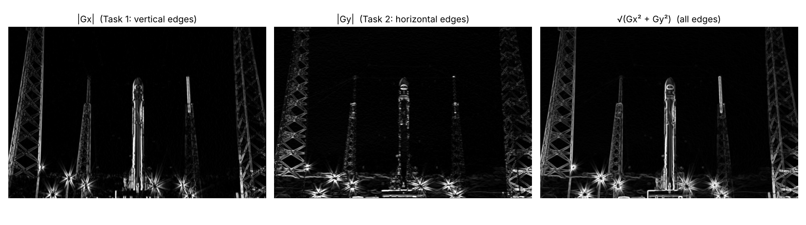

# Digital Image Processing — Week 4: Edge Detection Filters (Kenar Tespit Filtreleri)

**Group members: Nmertgules and Iliya**

3×3 Prewitt, Sobel and Laplacian kernels are tested on a grayscale image after light Gaussian smoothing, then compared. Every notebook runs on the CPU, and repeats its pipeline on the GPU when OpenCV was built with CUDA ([Week 1 setup](../week1/README.md)).



## Tasks

| Task | Notebook | Kernel(s) | Result |
| --- | --- | --- | --- |
| 1 | [Prewitt-x + Gauss](01_prewitt_x_gauss.ipynb) · [Colab](https://colab.research.google.com/github/iliyadindar/DEEP/blob/main/week4/01_prewitt_x_gauss.ipynb) | `[[-1 0 1], [-1 0 1], [-1 0 1]]` | vertical edges |
| 2 | [Prewitt-y + Gauss](02_prewitt_y_gauss.ipynb) · [Colab](https://colab.research.google.com/github/iliyadindar/DEEP/blob/main/week4/02_prewitt_y_gauss.ipynb) | `[[-1 -1 -1], [0 0 0], [1 1 1]]` | horizontal edges, plus both combined as √(Gx² + Gy²) |
| 3 | [Sobel x and y + Gauss](03_sobel_gauss.ipynb) · [Colab](https://colab.research.google.com/github/iliyadindar/DEEP/blob/main/week4/03_sobel_gauss.ipynb) | `[[-1 0 1], [-2 0 2], [-1 0 1]]` and its transpose | vertical and horizontal edges, magnitude |
| 4 | **[One-page comparison (Turkish)](SOBEL_VS_PREWITT.md)** · [measurements](04_sobel_vs_prewitt.ipynb) | Sobel vs. Prewitt | similarity, direction accuracy, noise, speed |
| 5 | [Laplacian + Gauss](05_laplacian_gauss.ipynb) · [Colab](https://colab.research.google.com/github/iliyadindar/DEEP/blob/main/week4/05_laplacian_gauss.ipynb) · **[comparison document (Turkish)](LAPLACIAN_VS_SOBEL_PREWITT.md)** | `[[0 1 0], [1 -4 1], [0 1 0]]` (and the 8-neighbour version) | edges as zero crossings, compared with Sobel and Prewitt |

> *1. `[[-1 0 1], [-1 0 1], [-1 0 1]]` 3×3 Prewitt filtresini gri tonlamalı bir görüntü üzerinde test ediniz. Filtreyi görüntü üzerinde çalıştırmadan önce Gauss filtresi ile görüntüyü hafif yumuşatınız.*
>
> *2. `[[-1 -1 -1], [0 0 0], [1 1 1]]` 3×3 Prewitt filtresini gri tonlamalı bir görüntü üzerinde test ediniz. Filtreyi görüntü üzerinde çalıştırmadan önce Gauss filtresi ile görüntüyü hafif yumuşatınız.*
>
> *3. 3×3 boyutunda yatay ve dikey Sobel filtrelerini benzer şekilde uygulayınız. Filtreleri görüntü üzerinde çalıştırmadan önce Gauss filtresi ile görüntüyü hafif yumuşatınız.*
>
> *4. Sobel ve Prewitt operatörlerinin sonuçlarını kıyaslayan bir sayfalık bir karşılaştırma metnini GitHub reponuza ekleyiniz.*
>
> *5. 3×3 boyutunda Laplacian Çekirdeği ile kenarların tespitini yapınız. Filtreleri görüntü üzerinde çalıştırmadan önce Gauss filtresi ile görüntüyü hafif yumuşatınız. Sonuçlarını Sobel ve Prewitt ile kıyaslayan bir karşılaştırma dokümanı hazırlayınız.*

Pipeline in every task: **color → grayscale → Gaussian 5×5, σ = 1 → edge kernel → |response| for display**.

## The idea in short

```
Prewitt-x     Prewitt-y      Sobel-x       Sobel-y
[-1 0 1]      [-1 -1 -1]     [-1 0 1]      [-1 -2 -1]
[-1 0 1]      [ 0  0  0]     [-2 0 2]      [ 0  0  0]
[-1 0 1]      [ 1  1  1]     [-1 0 1]      [ 1  2  1]
≈ ∂I/∂x       ≈ ∂I/∂y        ≈ ∂I/∂x       ≈ ∂I/∂y
vertical      horizontal     vertical      horizontal edges
```

- Each kernel is a central difference in one direction, averaged over 3 pixels in the other direction. Prewitt uses an equal average `[1 1 1]`; Sobel uses `[1 2 1]`, a tiny Gaussian. The weights sum to 0, so flat areas give 0.
- The y kernel is the **transpose** of the x kernel. Each kernel misses edges that run along its own difference direction, and diagonal edges show up in both.
- The output is **signed**, so it is computed in `float32` (`ddepth=cv2.CV_32F`). In `uint8`, half of the edges (the negative values) would be clipped to 0.
- **Why Gaussian first?** Derivatives amplify noise. A light blur removes pixel-level noise before differentiating. It also makes real edges less steep, so blurring too much weakens them. "Hafif" means using just enough.
- `cv2.filter2D` applies the kernel as written (correlation). Convolution would flip it, which only changes the sign for these kernels.

## Results

Test image: SpaceX Falcon 9 on the launch pad, 640×427, public domain ([source record](assets/sources.json)). It has strong vertical structures, plus horizontal and diagonal tower braces.

| | Task 1 · Prewitt-x | Task 2 · Prewitt-y | Task 3 · Sobel |
| --- | --- | --- | --- |
| Pipeline figure | [task1_05](results/task1_05_pipeline.png) | [task2_05](results/task2_05_pipeline.png) | [task3_04](results/task3_04_pipeline.png) |
| After Gaussian | [task1_03](results/task1_03_prewitt_x_gauss.png) | [task2_03](results/task2_03_prewitt_y_gauss.png) | [x](results/task3_01_sobel_x_vertical_edges.png) · [y](results/task3_02_sobel_y_horizontal_edges.png) · [magnitude](results/task3_03_sobel_magnitude.png) |
| Without Gaussian | [task1_04](results/task1_04_prewitt_x_no_gauss.png) | [task2_04](results/task2_04_prewitt_y_no_gauss.png) | (table below) |
| Noise comparison | [task1_06](results/task1_06_noise_comparison.png) | [task2_06](results/task2_06_noise_comparison.png) | (table below) |

Task 4 figures: [Sobel vs. Prewitt magnitudes and difference](results/task4_01_magnitudes_and_difference.png) · [edge strength vs. direction](results/task4_02_direction_test.png).

Task 5 figures: [pipeline](results/task5_03_pipeline.png) · [zoom: +/− pair and zero crossing](results/task5_04_zoom_double_line.png) · [Prewitt / Sobel / Laplacian edge maps](results/task5_05_compare_sobel_prewitt_laplacian.png) · [noise](results/task5_06_noise.png) · [direction test](results/task5_07_direction_test.png).

**Laplacian in short:** it is the second derivative, so an edge is where the response **crosses zero** (+ on the dark side, − on the bright side), not a peak. Zero crossings give 1–2 px thin edges, but the Laplacian has no direction information and is the most noise-sensitive of the three. The full comparison is in [LAPLACIAN_VS_SOBEL_PREWITT.md](LAPLACIAN_VS_SOBEL_PREWITT.md).

**Correctness checks**

- A hand-written NumPy filter matches `cv2.filter2D` exactly (max difference 0.0) in Tasks 1–2. Sobel via `filter2D` matches `cv2.Sobel` (max difference 1.4 × 10⁻⁴, float rounding).
- A 10 → 50 step edge gives 3 × 40 = **120** with Prewitt and 4 × 40 = **160** with Sobel, and 0 away from the edge.

**Effect of the Gaussian step:** edge-to-noise ratio = 99.5th percentile of |response| ÷ mean |response| in a flat sky patch. Higher is better.

| Input | Prewitt-x | Prewitt-y | Sobel (magnitude) |
| --- | --- | --- | --- |
| Clean, no Gauss → with Gauss | 26.5 → 28.8 | 32.0 → 32.8 | 21.6 → 23.3 |
| Noisy (σ = 15), no Gauss → with Gauss | 7.8 → 11.1 | 6.6 → 9.4 | 5.7 → 8.2 |

The blur lowers both the noise and the edge heights. The noise drops more, so edges stand out more clearly. The gain is large on the noisy image and small on the clean one. (Magnitudes combine two directions, so their ratios are not directly comparable to single-direction ones.)

**GPU run** (Google Colab, Tesla T4, OpenCV 5.0.0 built with CUDA 13.0 as in Week 1). Each notebook was executed top to bottom on that runtime. Times include upload/download:

| Task | max \|GPU − CPU\| | 640×427: CPU / GPU | 3840×2160: CPU / GPU |
| --- | --- | --- | --- |
| 1 · Gauss + Prewitt-x | 0.0001 | 0.41 / 1.01 ms | 56.75 / 18.83 ms |
| 2 · Gauss + Prewitt-y | 0.0002 | 0.65 / 1.16 ms | 45.98 / 18.05 ms |
| 3 · Gauss + Sobel x, y, magnitude | 0.0002 | 0.82 / 1.50 ms | 77.98 / 22.54 ms |
| 5 · Gauss + Laplacian | 0.0002 | 0.41 / 0.98 ms | 33.16 / 17.48 ms |

GPU and CPU agree up to float rounding. For the small image, the GPU is slower because copying to and from the GPU costs more than the filtering. At 4K, it is 1.9–3.5× faster. The CPU numbers here are from Colab's 2-core CPU. The notebooks saved in this folder were executed on a CPU-only machine, so their GPU cells show "skipped".

## Run it

**Colab with GPU:** first run the [Week 1 notebook](../week1/01_cuda_opencv_colab_setup.ipynb) with `USE_DRIVE = True`, which caches the CUDA build in Google Drive. Then open a Week 4 notebook with the Colab link, select a T4 GPU runtime, and run all. Its first cell restores the CUDA build from Drive. Without the cache, everything runs on the CPU.

**Local (CPU):** from the repository root,

```
pip install -r requirements.txt
for n in 01_prewitt_x_gauss 02_prewitt_y_gauss 03_sobel_gauss 04_sobel_vs_prewitt 05_laplacian_gauss; do
  jupyter nbconvert --to notebook --execute week4/$n.ipynb --output-dir week4/executed
done
```

The saved outputs in this folder come from OpenCV 5.0.0, NumPy 2.5.3 and Python 3.13 on a CPU-only Linux machine.
