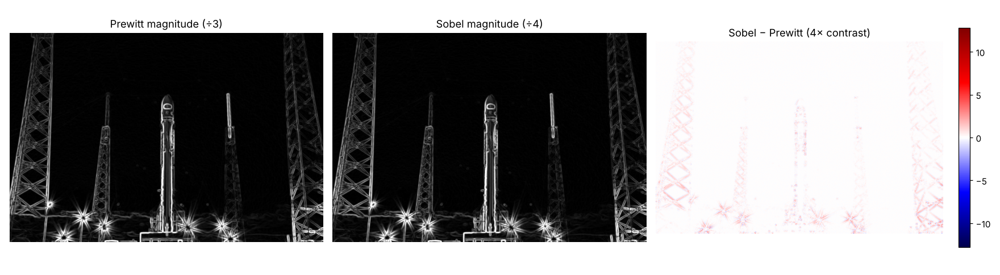

# Sobel ve Prewitt Operatörlerinin Karşılaştırılması

**Grup: Nmertgules ve Iliya** · Hafta 4, Görev 4 · Ölçümler: [04_sobel_vs_prewitt.ipynb](04_sobel_vs_prewitt.ipynb)

## Kerneller

```
Prewitt-x        Sobel-x          Ayrıştırılmış hali (x yönü)
[-1  0  1]       [-1  0  1]       Prewitt = [1 1 1]ᵀ · [-1 0 1]
[-1  0  1]       [-2  0  2]       Sobel   = [1 2 1]ᵀ · [-1 0 1]
[-1  0  1]       [-1  0  1]       (y kernelleri bunların transpozudur)
```

İki operatör de aynı türevi, yani merkezî farkı (`I(x+1) − I(x−1)`) hesaplar. Tek fark, kenara dik yöndeki ortalamadadır. Prewitt üç satırı eşit ağırlıkla (`[1 1 1]`) toplar. Sobel ise orta satıra iki kat ağırlık verir (`[1 2 1]`); bu küçük bir Gauss yumuşatmasıdır. Bu yüzden kazançları farklıdır: 40 birimlik bir basamak Prewitt'te **120**, Sobel'de **160** verir. Aşağıdaki karşılaştırmalarda çıktılar kazanca (3 ve 4) bölünmüştür. Tüm deneylerde aynı görüntü (640×427 gri) ve aynı hafif Gauss filtresi (5×5, σ = 1) kullanılmıştır.

## Sonuçlar

| Ölçüt | Prewitt | Sobel |
| --- | --- | --- |
| Gerçek görüntüde iki büyüklük haritasının korelasyonu | 0.9997 | (aynı) |
| Ortalama mutlak fark / ortalama büyüklük | 2.0 % | (aynı) |
| Daire testi: 360 yönde kenar şiddeti farkı (maks − min) / ortalama | 11.6 % | **9.2 %** |
| Daire testi: gradyan yön hatası, ortalama / en büyük | 1.26° / 2.21° | **0.60° / 1.27°** |
| Kenar/gürültü oranı, temiz görüntü + Gauss | **23.5** | 23.3 |
| Kenar/gürültü oranı, gürültülü (σ = 15) + Gauss | **8.4** | 8.2 |
| Kenar/gürültü oranı, gürültülü, Gauss yok | **5.8** | 5.7 |
| CPU süresi, x + y + büyüklük (`filter2D`) | 0.63 ms | 0.58 ms |



## Yorum

1. **Gerçek görüntüde sonuçlar neredeyse aynıdır.** Kazanç eşitlendiğinde iki harita %99.97 korelasyonludur, ortalama fark %2'dir. Aynı kenarlar bulunur: Task 1–3'teki figürlerde x kernelleri dikey kenarları, y kernelleri yatay kenarları, ikisi birden çapraz kenarları gösterir. Farklar yalnızca ince detaylarda, köşelerde ve çapraz kenarlarda görülür.
2. **Sobel yönlere karşı daha dengelidir.** Her yönde kenar içeren bir daire üzerinde, Sobel'in kenar şiddeti yöne göre daha az değişir (%9.2 ve %11.6). Hesapladığı gradyan yönü de yaklaşık iki kat daha doğrudur (ortalama 0.60° ve 1.26°). Yön bilgisinin kullanıldığı işlemler (Canny'deki non-maximum suppression, HOG gibi öznitelikler) için bu fark önemlidir. Sobel'in daha yaygın olmasının ana nedeni budur. ([Grafik](results/task4_02_direction_test.png))
3. **Gürültüde Prewitt çok az daha iyidir.** Eşit ağırlıklı `[1 1 1]/3` ortalaması beyaz gürültünün varyansını 1/3'e, `[1 2 1]/4` ise 6/16 ≈ 0.375'e indirir. Ölçülen fark da bu yönde ve küçüktür (8.4 ve 8.2). İki operatörde de asıl kazancı **önceden uygulanan Gauss filtresi** sağlar: gürültülü görüntüde oran 5.8 → 8.4 (Prewitt) ve 5.7 → 8.2 (Sobel) olur.
4. **Hız farkı ihmal edilebilir.** İki kernel de 3×3 boyutundadır ve ayrıştırılabilir; `filter2D` ile süreleri aynıdır. `cv2.Sobel` hazır fonksiyonu ayrıştırılmış uygulamayı kullandığı için daha hızlıdır (0.39 ms). GPU'da (Colab T4) iki operatör de CPU ile aynı sonucu verir (fark < 0.001). GPU, kopyalama maliyeti nedeniyle yalnızca büyük görüntülerde hızlıdır (4K görüntüde 2.5–3.5 kat hızlanma).

## Sonuç

Bu görüntüde iki operatör pratikte aynı kenarları bulur. **Sobel**, yönlere karşı daha tutarlı olduğu ve gradyan yönünü daha doğru verdiği için genel kullanımda tercih edilir. **Prewitt** daha basittir ve beyaz gürültüye çok az daha dayanıklıdır, ama bu fark ihmal edilebilir düzeydedir. Her iki durumda da kenar kalitesini en çok etkileyen adım, türevden önce yapılan **hafif Gauss yumuşatmasıdır**.
