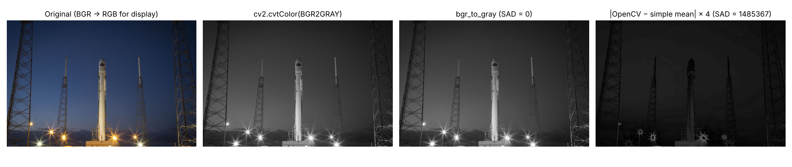
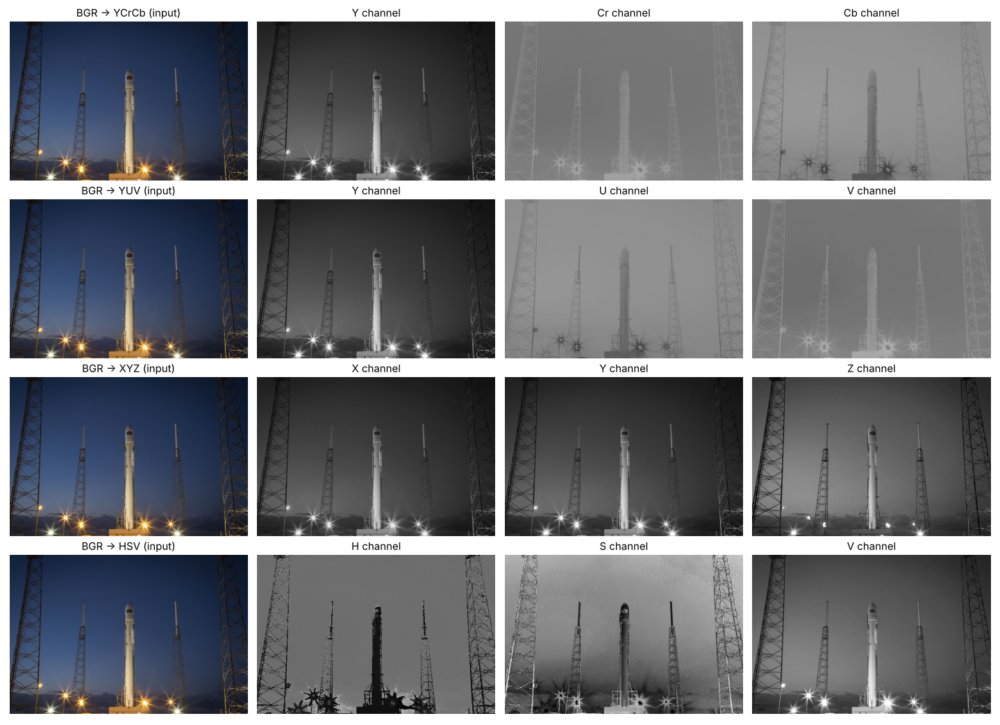
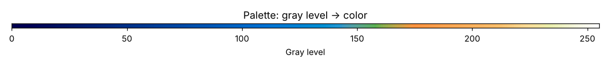
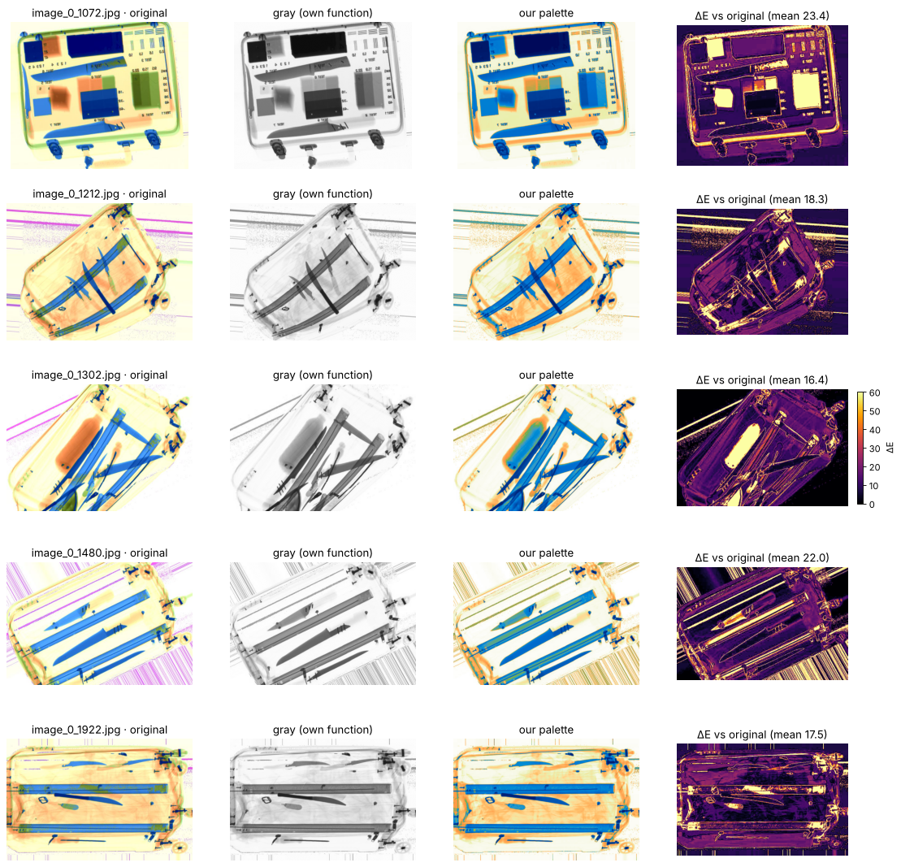

# Digital Image Processing — Week 5: Color Histograms, Grayscale, Color Spaces, X-ray Pseudocolor

**Group members: Nmertgules and Iliya**

## Görevler

| Görev | Dosya | Yapılan işlem |
| --- | --- | --- |
| 1 | [OpenCV histogramları](01_color_histograms_opencv.ipynb) | Renkli görüntüyü oku ve göster; B, G, R kanallarının histogramlarını `cv2.calcHist` ile (renkli görüntü üzerinde `channels=[i]`) ayrı hesapla, ayrı ayrı ve üst üste çiz. |
| 2 | [Elle histogram hesabı](02_color_histograms_manual.ipynb) | `calc_hist` fonksiyonunu piksel sayaçlarıyla kendimiz yaz (isteğe bağlı `bins`, `value_range`, `mask`); her kanalda ayrı çalıştır ve çiz. |
| 3 | [Gri dönüşüm](03_grayscale.ipynb) | Görüntüyü hem `cv2.cvtColor` hem kendi fonksiyonumuzla tek kanallı griye çevir; eşleşen piksellerin mutlak farklarının toplamını hata değeri olarak raporla. |
| 4 | [Renk uzayları](04_color_spaces.ipynb) | BGR → GRAY / YCrCb / YUV / XYZ / HSV ve YCrCb → BGR dönüşümlerini kendimiz yaz; dönüşüm tablosu (fonksiyon pointer karşılığı) ile çağır; `cv2.cvtColor` ile karşılaştır, hata değerlerini yazdır. |
| 5 | [X-ray renklendirme](05_xray_pseudocolor.ipynb) | HUMS X-ray veri setinin `ThreatsRGB` klasöründen 5 görüntüyü griye çevir, operatörler için renklendir, palet seçimini açıkla, orijinalle farkları yorumla. |
| Haftalık ödev | [CUDA](06_cuda.ipynb) | Görev 1–5'in tamamını CUDA C++ kernel'larıyla (CuPy `RawModule`) yeniden gerçekle; Görev 4'te `__device__` fonksiyon pointer tablosu. |

Her histogram 256 kutuludur: yatay eksen 0–255 piksel değerini, dikey eksen bu değere sahip piksel sayısını gösterir. OpenCV kanalları **BGR** sırasıyla okur; fotoğraf ekranda RGB'ye çevrilerek doğru renklerle gösterilir.

## Çalıştırma

Repoyu bütünüyle indirin. `pip install -r week5/requirements.txt` komutundan sonra notebook'ları VS Code/Jupyter'da Python ortamınızı seçerek baştan sona çalıştırın. Repo kökünden veya `week5` klasöründen çalışırlar. 03–06 notebook'ları repo dışında (ör. Colab) açıldığında fotoğrafı GitHub'dan kendileri indirir.

- Görev 1–4'ün girdisi, Week 4'teki mevcut [renkli rocket.jpg](../week4/assets/rocket.jpg) fotoğrafıdır; [kaynak ve lisans kaydı](../week4/assets/sources.json) aynı yerde tutulur.
- Görev 5, [HUMS X-ray Dataset](https://www.kaggle.com/datasets/orvile/hums-x-ray-dataset)'i `kagglehub` ile indirir (~128 MB, herkese açık). Görevde klasör adı "ThreadsRGB" olarak geçiyor; veri setindeki gerçek adı `ThreatsRGB`'dir.
- `06_cuda.ipynb` NVIDIA GPU ve CuPy ister. Colab'da *Runtime → Change runtime type → T4 GPU* seçin; CuPy Colab'da hazırdır. Kendi bilgisayarınızda CUDA 12 için `pip install cupy-cuda12x`.

Notebook'ların kaydedilmiş çıktıları GitHub üzerinde görülebilir.

## Çalıştırılan sonuçlar

**Görev 1–2.** 640 × 427 renkli görüntüde her kanalın histogram toplamı **273.280 piksel** oldu. Elle yazılan fonksiyon, üç kanalın tamamında OpenCV ile **birebir aynı** sonucu verdi; maksimum kutu farkı **0**. Elle sonucu bilinen küçük görüntü, tamamen 0, tamamen 255 ve sabit tohumlu rastgele görüntü kontrolleri de geçti. Farklı kutu sayıları, değer aralıkları ve dairesel maske ile yapılan karşılaştırmalar da OpenCV ile birebir aynı çıktı. Kutu indeksi tam sayı işlemiyle hesaplandığı için aralık kutu sayısına tam bölünmediğinde de sonuç kesindir; OpenCV bu durumda tam kutu sınırındaki bazı değerleri kayan nokta yuvarlaması yüzünden alt kutuya koyabilir. Görev 2'de hazır histogram fonksiyonu yalnızca sonuç doğrulaması için kullanılır; asıl hesap iki döngü ve sayaçlarla yapılır.

**Görev 3.** Kendi gri dönüşüm fonksiyonumuz OpenCV'nin 8 bit hesabıyla aynı 15 bit sabit noktalı BT.601 katsayılarını (9798, 19235, 3735) kullanır. **Hata değeri (mutlak farklar toplamı) 0**; bütün 16.777.216 olası renkte de 0. Aynı formülün kayan noktalı hali fotoğrafta 1, bütün renklerde 22.906 hata verir (yalnızca 1 seviyelik yuvarlama farkları). Karşılaştırma için: kanalların basit ortalaması 1.485.367, BGR'yi RGB sanmak 2.060.383 hata üretir.

**Görev 4.** Altı dönüşümün hepsinde, hem fotoğrafta hem de bütün 16.777.216 renkte **hata değeri 0** (beklenen değer). Bunun için OpenCV'nin yuvarlama biçimi de aynen uygulandı: sabit noktalı katsayılar, `CV_DESCALE`, HSV bölme tabloları ve 0–255 kırpma. Sonuç OpenCV 4.12 ve 5.0 ile kontrol edildi.

**Görev 5.** Palet, operatörlerin bildiği çift enerjili X-ray renk dilini izler (mavi: metal/yoğun, yeşil: karışık, turuncu: organik, koyu: içinden geçilemeyen). Hangi gri seviyenin hangi renge gideceği, seçilen 5 görüntü dışındaki 145 görüntünün istatistiğinden belirlendi; renklerin açıklığı gri seviyeyi izler (CIELAB `L*`). Orijinalle karşılaştırıldığında mavi piksellerin %93,5'i, turuncu piksellerin %80,6'sı aynı renkte kalırken yeşilin yalnızca %6,8'i geri geldi; ortalama ΔE 16–23. Fark, orijinal rengin iki enerji ölçümünden (madde türü) gelmesinden, gri görüntüde ise yalnızca toplam zayıflamanın kalmasından kaynaklanır: bu bir yoğunluk renklendirmesidir, madde renklendirmesi değildir. Ayrıntılı yorum notebook'ta.

**Haftalık ödev (CUDA).** `06_cuda.ipynb` her görevi CUDA kernel'larıyla yapar ve sonucu OpenCV/CPU sürümüyle karşılaştırır (beklenen hata değeri her yerde 0). Kernel kaynağı NVRTC ile T4 (sm_75) ve A100 (sm_80) için hatasız derlendi; dönüşüm fonksiyonlarının mantığı CPU'da bütün 16.777.216 renkte OpenCV ile karşılaştırıldı (hata 0). Bu notebook'un çıktıları ve süre ölçümleri GPU'lu bir ortamda (ör. Colab T4) çalıştırıldığında oluşur.
