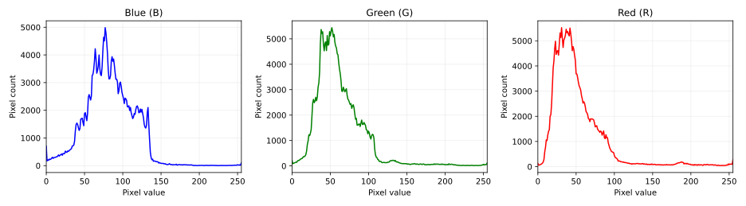
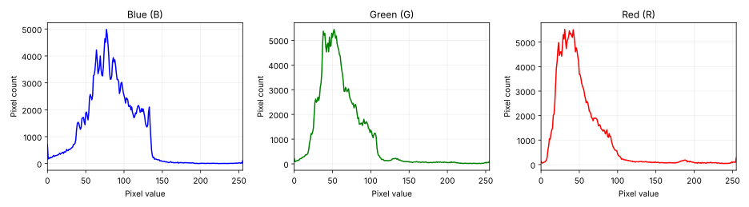
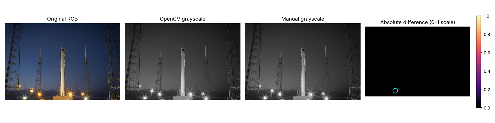
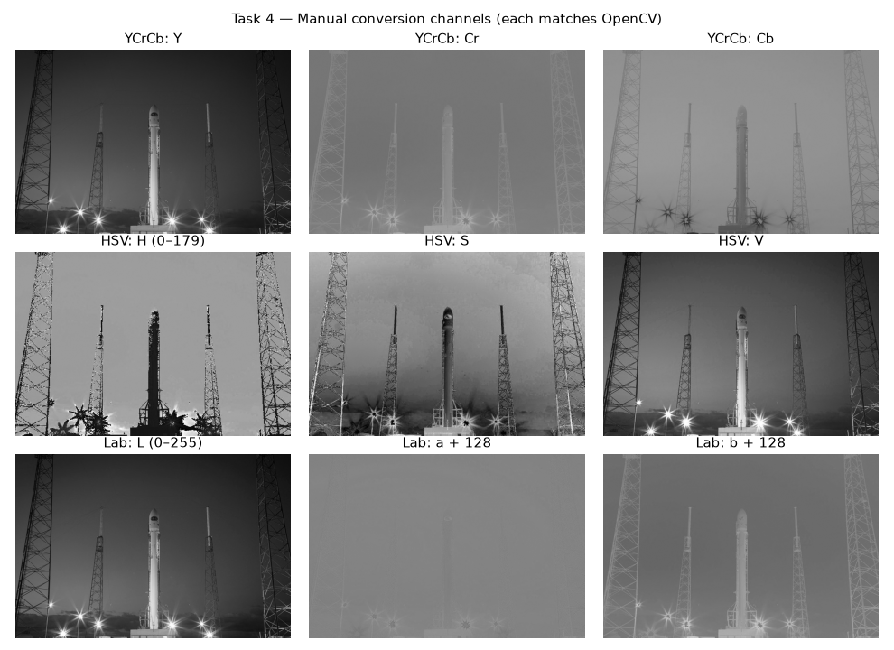
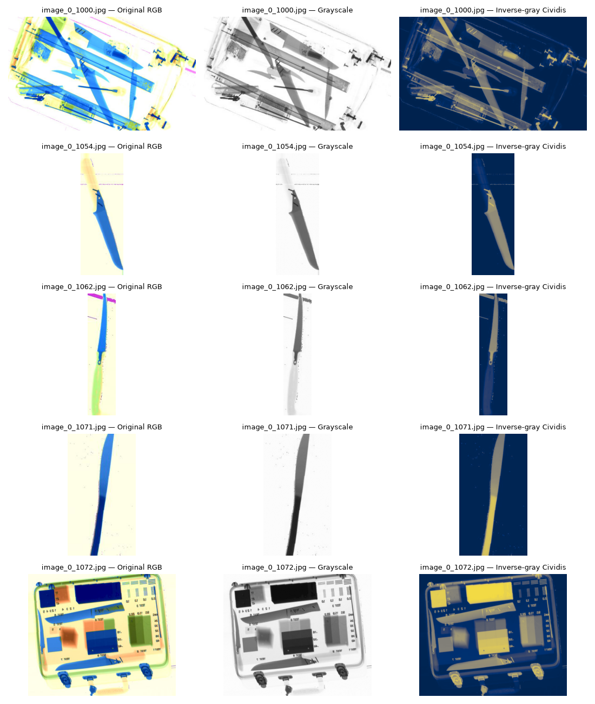

# Digital Image Processing — Week 5: Color Histograms, Color Spaces and X-ray Recoloring

**Group members: Nmertgules and Iliya**

## Görevler

| Görev | Dosya | Yapılan işlem |
| --- | --- | --- |
| 1 | [OpenCV histogramları](01_color_histograms_opencv.ipynb) | Renkli görüntüyü oku ve göster; `cv2.calcHist`'i renkli görüntüye uygulayıp `channels=[i]` ile B, G, R kanallarını tek tek seç, ayrı çiz ve üçünü bir grafikte karşılaştır. |
| 2 | [Elle histogram hesabı](02_color_histograms_manual.ipynb) | `calc_hist` fonksiyonunu piksel sayaçlarıyla kendimiz yaz; her kanalda ayrı çalıştır, çiz ve OpenCV ile üst üste karşılaştır. |
| 3 | [Griye dönüşüm ve karşılaştırma](03_grayscale_comparison.ipynb) | Renkli görüntüyü OpenCV ve kendi ağırlıklı dönüşümümüzle tek kanallı griye çevir; aynı konumdaki pikselleri karşılaştırıp farkları raporla. |
| 4 | [Renk uzayı dönüşümleri](04_color_space_conversions.ipynb) | Kendi YCrCb/HSV/Lab fonksiyonları ve sıfır hata karşılaştırması; ek HSI/normalize rgb. |
| 5 | [X-ray renklendirme](05_xray_recoloring.ipynb) | Beş ThreatsRGB görüntüsü: griye dönüşüm, Cividis paleti, seçim gerekçesi ve yorumlar. |

Varsayılan histogram 256 kutuludur: yatay eksen 0–255 piksel değerini, dikey eksen bu değere sahip piksel sayısını gösterir. OpenCV kanalları **BGR** sırasıyla okur; fotoğraf ekranda RGB'ye çevrilerek doğru renklerle gösterilir.

`calc_hist(channel, bins=256, value_range=(0, 256), mask=None)` imzası `cv2.calcHist`'e benzer: kutu sayısı ve yarı açık `[alt, üst)` değer aralığı seçilebilir, aralık dışındaki değerler sayılmaz, maske verilirse yalnızca maskesi sıfırdan farklı pikseller sayılır. Hesap yine iki döngüyle, her piksel için `kutu = (değer − alt) × kutu_sayısı // aralık_genişliği` tam sayı formülüyle yapılır.

## Çalıştırma

Repoyu bütünüyle indirin. `pip install -r week5/requirements.txt` komutundan sonra notebook'ları VS Code/Jupyter'da Python ortamınızı seçerek baştan sona çalıştırın. Repo kökünden veya `week5` klasöründen çalışırlar: notebook, çalışılan klasörden yukarı doğru `week4/assets/rocket.jpg` dosyasını arayarak repo kökünü kendisi bulur.

Girdi, Week 4'teki mevcut [renkli rocket.jpg](../week4/assets/rocket.jpg) fotoğrafıdır; [kaynak ve lisans kaydı](../week4/assets/sources.json) aynı yerde tutulur. Notebook'ların kaydedilmiş çıktıları GitHub üzerinde görülebilir.

## Çalıştırılan sonuçlar

640 × 427 renkli görüntüyle iki görev de CPU'da çalıştırıldı. Her kanalın histogram toplamı **273.280 piksel** oldu. Elle yazılan fonksiyon, üç kanalın tamamında OpenCV ile **birebir aynı** sonucu verdi; maksimum kutu farkı **0**.

Elle sonucu bilinen küçük görüntü, tamamen 0, tamamen 255 ve sabit tohumlu rastgele görüntü kontrolleri de geçti. Farklı kutu sayıları ve aralıklar (0–256'da 32 ve 16 kutu, 64–192'de 8 kutu, 50–200'de 15 kutu), dairesel maske ve hatalı girdilerin reddedilmesi de OpenCV'ye karşı test edildi.

Not: Aralık genişliği kutu sayısına tam bölünmediğinde OpenCV kayan noktalı hesap yüzünden tam kutu sınırındaki bir değeri bazen alttaki kutuya koyar; örneğin 50–200 aralığında 10 kutuda 65 değeri 1. değil 0. kutuya düşer (OpenCV 5.0 ile görüldü). `calc_hist` tam sayı aritmetiği kullandığı için bu durumda doğru kutuyu verir; bu yüzden OpenCV karşılaştırmaları yalnızca OpenCV'nin de tam sonuç verdiği aralıklarla yapılır, sınır davranışı ayrıca elle test edilir. Görev 2'de hazır histogram fonksiyonu yalnızca sonuç doğrulaması için kullanılır; asıl hesap iki döngü ve 256 sayaçla yapılır.

Bu maddelerde thread/CUDA istenmediği için bu teslim normal CPU uygulamasıdır.

## Görev 3 — Griye dönüşüm sonuçları

`Y = 0.299R + 0.587G + 0.114B` formülü kendi fonksiyonumuzda uygulanır. Kanal sırası BGR olarak ele alınır. Hesap kayan nokta olmadan tam sayı aritmetiğiyle yapılır: `(114·B + 587·G + 299·R + 500) // 1000`, yani en yakın tam sayıya tam doğru yuvarlama. İki çıktı da tek kanallı uint8 görüntüdür. Fark hesabından önce int16'ya dönüştürülerek taşma önlenir.

| Ölçüt | Sonuç |
| --- | --- |
| Toplam piksel | 273280 |
| Farklı piksel | 1 (%0.0004) |
| Maksimum mutlak fark | 1 gri seviye |
| Ortalama mutlak fark | 0.000004 |
| RMSE | 0.001913 |

Farklı olan tek piksel (satır 392, sütun 183; BGR = 87, 205, 255) için tam değer 206,498'dir: doğru yuvarlama 206'dır, kendi fonksiyonumuz 206, OpenCV 207 verir. Yani fark OpenCV'nin sabit noktalı katsayı yaklaşımından gelir; bizim sonucumuz formüle göre tam doğrudur. Sonuçlar gözle aynıdır; aynı oldukları varsayılmadan piksel düzeyinde karşılaştırılmıştır.

Siyah/beyaz ve saf BGR renkleri, 256 nötr gri ve sabit tohumlu rastgele görüntü kontrolleri geçti. Olası 256³ = 16.777.216 rengin tamamı da denendi: 20.753 renkte (%0,12) OpenCV ile 1 gri seviye fark var, hiçbir renkte fark 1'i geçmiyor (OpenCV 5.0).

Fark paneli 0–1 ölçeğinde gösterilir ve farklı pikseller camgöbeği halkayla işaretlenir; tek piksel bu boyutta tek başına görünmez. [Gerçek mutlak fark görüntüsü](results/task3_absolute_difference.png) 0–255 gösterimde neredeyse siyah görünür. [OpenCV çıktısı](results/task3_opencv_gray.png) · [Kendi çıktımız](results/task3_manual_gray.png) · [Sayısal sonuçlar](results/task3_metrics.json).

## Görev 4 — Renk uzayı dönüşümleri (CPU)

[Uygulama modülü](color_conversions.py) kendi dönüşüm hesaplarını içerir. Notebook, YCrCb/HSV/Lab için hazır OpenCV dönüşümünü yalnız referans olarak çağırır. Ödev görüntüsünde ve **16.777.216 olası rengin tamamında** üç dönüşümün her biri için toplam mutlak hata **0**, maksimum hata **0** oldu (OpenCV 5.0.0). Test tekrar üretilebilir ve partiler hâlinde çalışır. HSI ve normalize rgb de PDF formülleriyle uygulanıp kontrol edildi; bunlar için doğrudan OpenCV referansı olmadığı açıkça belirtilir. [Sayısal rapor](results/task4_metrics.json).

## Görev 5 — X-ray renklendirme (CPU)

Beş özgün **ThreatsRGB** görüntüsü ve [kaynak kayıtları](assets/xray_sources.json) eklendi. Kaggle toplu indirme bağlantısı 404 verdiği için veri seti sahibinin özgün GitHub deposu kullanıldı. Klasörün gerçek adı `ThreatsRGB`; ödevdeki `ThreadsRGB` ile bu kastedildiği kabul edildi.

Görüntüler önce tek kanallı griye, ardından ters gri üzerinde **Cividis** paletine çevrildi. Açık arka plan koyu maviye, koyu nesneler sarıya yaklaşır; tekdüze bir ölçekle şekil ve parlaklık farkları gösterilir. Malzeme sınıfları geri kazanılmaz; renklendirme bir tehdit dedektörü değildir. Her görüntünün ayrı yorumu ve özgün renklendirmeyle farkları notebook'ta verilir. Operatör başarımı için insan deneyi yapılmadı.

Beş görüntüde boyut, veri türü, kaynak SHA256 ve palet eşleme kontrolleri geçti. [Sayısal renk farkları](results/task5_metrics.json) doğruluk puanı değil, iki renklendirmenin farklılığını gösteren ölçümlerdir.

Bu iki yeni görev **CUDA kullanmadan** tamamlandı. CUDA sürümleri bu teslimde eklenmedi.
