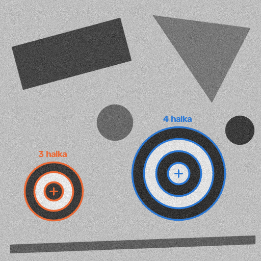
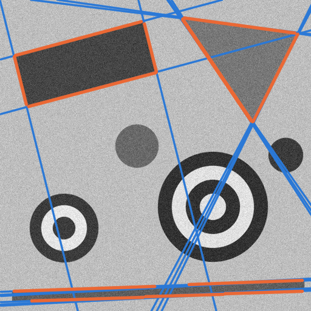
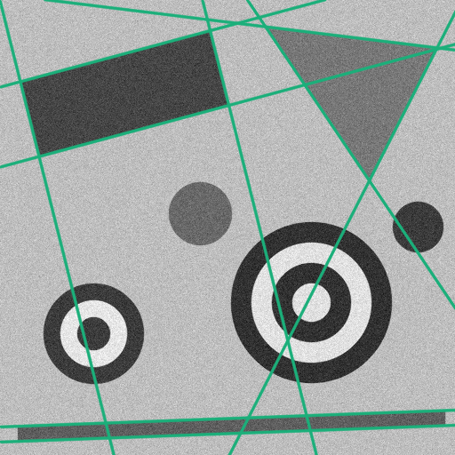
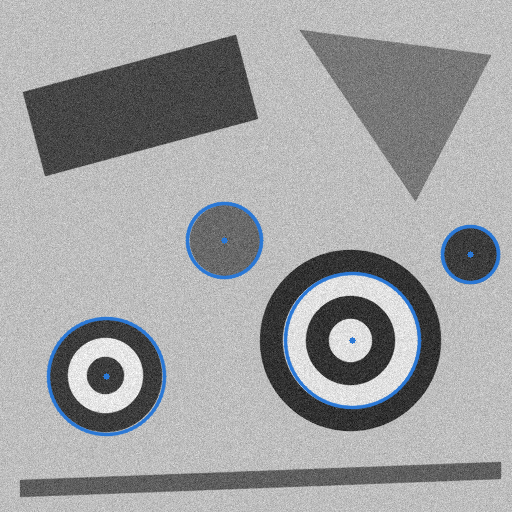
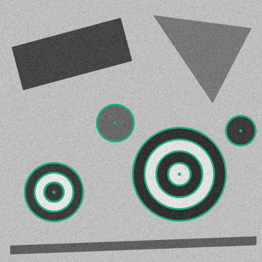
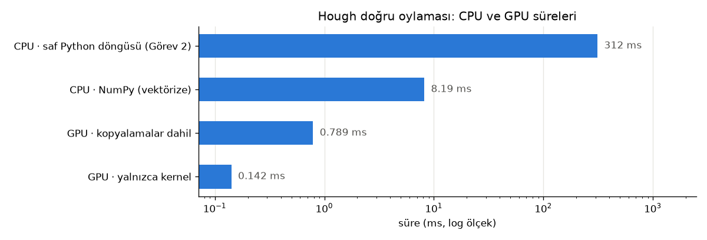

# Digital Image Processing — Week 6: Hough Transform (Hough Dönüşümü)

**Group members: Nmertgules and Iliya**

Doğru, çember ve eş merkezli çember bulma: önce OpenCV fonksiyonlarıyla, sonra tamamen kendi yazdığımız Hough dedektörleriyle; son olarak doğru dönüşümünün oylaması CUDA C++ ile GPU'da paralel yapılır.

## Dosyalar

| Dosya | İçerik |
| --- | --- |
| [hough_odev.ipynb](hough_odev.ipynb) · [Colab](https://colab.research.google.com/github/iliyadindar/DEEP/blob/main/week6/hough_odev.ipynb) | Bütün görevler; açıklamalar ve kod yorumları Türkçe, çıktılarıyla kaydedildi |
| [hough_odev.html](hough_odev.html) | Notebook'un HTML çıktısı (`jupyter nbconvert --to html`) |
| [results/](results/) | Notebook'un kaydettiği sonuç görüntüleri (Görev 2'nin oylama matrisi dahil) |

## Görevler

| Görev | Yapılan işlem |
| --- | --- |
| 1 | Canny → median filtre → `cv2.HoughLines` (mavi, sonsuz doğrular) ve `cv2.HoughLinesP` (turuncu, parçalar) |
| 2 | Kendi Hough doğru dedektörümüz: sin/cos tabloları bir kez hesaplanır, kenar pikselleri üzerinde açık döngüyle (ρ, θ) oylaması, oylama matrisi resim olarak kaydedilir, eşik + tepe bastırma ile doğrular |
| 3 | Canny → median filtre → `cv2.HoughCircles` (mavi) |
| 4 | Kendi Hough çember dedektörümüz: 3B oylama matrisi `[r, b, a]`, sin/cos tablosundan oy şablonu, açık oylama, oy oranı eşiği; yarıçap dilimleri görüntü olarak |
| 5 | Kendi eş merkezli çember dedektörümüz: eş merkezlilik **oylamanın içinde** yakalanır (aşağıda) |
| 6 | Hough doğru oylaması CUDA ile: `%%writefile` + `nvcc`, kenar pikseli başına thread, `atomicAdd`, sin/cos tabloları `__constant__` bellekte; CPU sonucuyla birebir karşılaştırma ve süre ölçümü |
| 7 | Kendi fotoğrafınız üzerinde deneme (yüklenmezse scikit-image `coins` fotoğrafı) |

Test görüntüsü sentetiktir (512 × 512, σ = 10 gürültü): 9 doğru (dikdörtgen, üçgen, şerit), 2 eş merkezli küme (4 ve 3 halka) ve 2 tek disk, toplam 9 çember. Gerçek değerler bilindiği için her yöntem Bölüm 8'de bunlarla karşılaştırılır.

## Çalıştırma

**Colab:** yukarıdaki Colab bağlantısını açın, *Çalışma zamanı → Çalışma zamanı türünü değiştir → T4 GPU* seçip *Tümünü çalıştır*. İlk hücre kütüphaneleri kontrol eder, `nvidia-smi` ve `nvcc --version` çıktılarını gösterir. Kendi fotoğrafınızı denemek için Bölüm 0.2'deki hücrede `FOTOGRAF_YUKLE = True` yapın.

**Kendi bilgisayarınızda:** `pip install -r week6/requirements.txt`; Bölüm 6 için NVIDIA GPU ve CUDA Toolkit (`nvcc`) gerekir. Notebook `week6` klasöründen çalıştırılır; sonuç görüntülerini `results/`, CUDA ara dosyalarını `outputs/` (git dışı) altına yazar.

Kaydedilen çıktılar WSL2 Ubuntu 24.04 üzerinde, NVIDIA RTX 5070 Ti (compute capability 12.0) ve CUDA 13.0 ile, Python 3.12 + OpenCV 5.0.0 kullanılarak üretildi. Görev 1–5'in tespitleri OpenCV 4.13 ile de karşılaştırıldı ve aynı çıktı. Süreler makineye göre değişir (Colab T4'te farklı olur).

## Sonuçlar

**Kenar çıkarma (Canny → median).** Canny'nin kenarları 1 piksel kalınlığındadır; 3×3 median doğrudan uygulanırsa bir çizgi üzerindeki 9 pikselin yalnızca 3'ü beyaz olduğundan kenar silinir: 5.212 kenar pikselinden 1.237'si kaldı (%76 kayıp). Bu yüzden median filtre üç adımda uygulandı: kenarları 3×3 kalınlaştır → 5×5 median → sonucu ince Canny kenarları için maske olarak kullan. Bu yöntem hiçbir gerçek kenarı silmez ve yalnızca 1–2 piksellik kırıntıları temizler (sentetik görüntüde 0, `coins` fotoğrafında 4 piksel).

**Doğrular (Görev 1, 2, 6).**

| Yöntem | Bulunan (9 gerçek doğru) | Tekrar | Süre |
| --- | --- | --- | --- |
| `cv2.HoughLines` (eşik 65) | 9/9 | 9 | 1,7 ms |
| `cv2.HoughLinesP` | 9/9 | 4 (bölünmüş parça) | 6,5 ms |
| Kendi dedektörümüz (Görev 2, saf Python) | 9/9 | 0 | 312 ms |
| Aynı oylama, CUDA kernel (Görev 6) | 9/9 | 0 | 0,14 ms |

`HoughLines` bir hücreyi yalnızca 4 komşusundan büyükse doğru saydığı için aynı kenara komşu hücrelerden tekrarlı doğrular döndürür; eşik 80'e çıkınca tekrarlar 3'e iner ama dikdörtgenin iki kısa kenarı kaybolur (7/9). Kendi dedektörümüz tepe bastırma (±10 ρ hücresi, ±3°) uyguladığı için dokuz doğruyu tekrarsız bulur.

[Görev 2 oylama matrisi](results/gorev2_akumulator.png) log ölçekli, `Blues` renk haritalı ve tam çözünürlüklüdür (1.451 ρ satırı; θ sütunları 4 piksel genişliğinde).

**Çemberler (Görev 3, 4).** `cv2.HoughCircles` dokuz çemberden 4'ünü buldu: her merkez için tek yarıçap seçtiği ve `minDist` yakın merkezleri bastırdığı için eş merkezli kümelerin her birinden yalnızca bir halka döner. Kendi 3B (a, b, r) dedektörümüz dokuz çemberin hepsini merkezde 0, yarıçapta en fazla 1 piksel hatayla buldu (81 × 512 × 512 oylama matrisi, 2,3 s). Oylamanın iç satırı NumPy ile yazıldı; aynı oylamanın tamamen döngülü hali küçük bir parçada birebir aynı matrisi verir.

**Eş merkezli çemberler (Görev 5).** Önce çember bulup sonra merkezlerine göre gruplamak yerine eş merkezlilik oylamanın içinde yakalandı:

1. Her kenar pikseli, merkezi yalnızca **gradyan doğrultusu** üzerinde arar: (a, b) = (x, y) ∓ r·(cos φ, sin φ), r = 15…95; cos φ ve sin φ tablodan okunur.
2. Her oy hem 3B matrise `A[r, b, a]` hem de aynı döngüde **ortak merkez haritasına** `C[b, a]` eklenir; C'deki ağırlık 1 / 2πr olduğu için her tam halka merkezine, büyüklüğünden bağımsız olarak, aynı katkıyı yapar. C'nin değeri o merkezi paylaşan halka sayısıyla büyür.
3. C'nin eşiği geçen tepeleri küme merkezleridir; halkaların yarıçapları o merkezdeki `A[:, b, a]` sütunundan okunur.

| Merkez | C desteği (3×3) | Bulunan yarıçaplar | Gerçek |
| --- | --- | --- | --- |
| (350, 340) | 9,21 | 21, 44, 68, 91 | 21, 44, 67, 90 |
| (105, 375) | 8,05 | 18, 38, 57 | 18, 37, 56 |
| (470, 255) tek disk | 3,04 (< 4,0 eşik) | — | 28 |
| (225, 241) tek disk | 1,80 (< 4,0 eşik) | — | 35 |

**CUDA (Görev 6).** GPU'nun oylama matrisi Görev 2'deki CPU matrisiyle birebir aynıdır (261.180 hücrenin hiçbiri farklı değil). Bunun için GPU'da da `double` kullanıldı, tablolar CPU'dan aynen kopyalandı, ρ yuvarlaması iki tarafta da `floor(v + 0.5)` ve derleme `-fmad=false` ile yapıldı (FMA, ara çarpımı yuvarlamadığı için sınırdaki bir ρ'yu komşu hücreye düşürebilirdi).

| Yöntem | Süre | Saf Python döngüsüne göre |
| --- | --- | --- |
| CPU, saf Python döngüsü (Görev 2) | 312 ms | 1× |
| CPU, NumPy (vektörize) | 8,2 ms | 38× |
| GPU, kopyalamalar dahil | 0,79 ms | 396× |
| GPU, yalnızca kernel (100 çalıştırma ortalaması) | 0,14 ms | 2205× |

Özet: OpenCV fonksiyonları hız ve kullanım kolaylığında önde. Kendi uygulamalarımız oylama adımını görünür kılıyor ve OpenCV'nin yapmadığı iki şeyi yapıyor: tepe bastırma ile tekrarsız doğrular ve aynı merkezdeki bütün halkaları bulmak.
