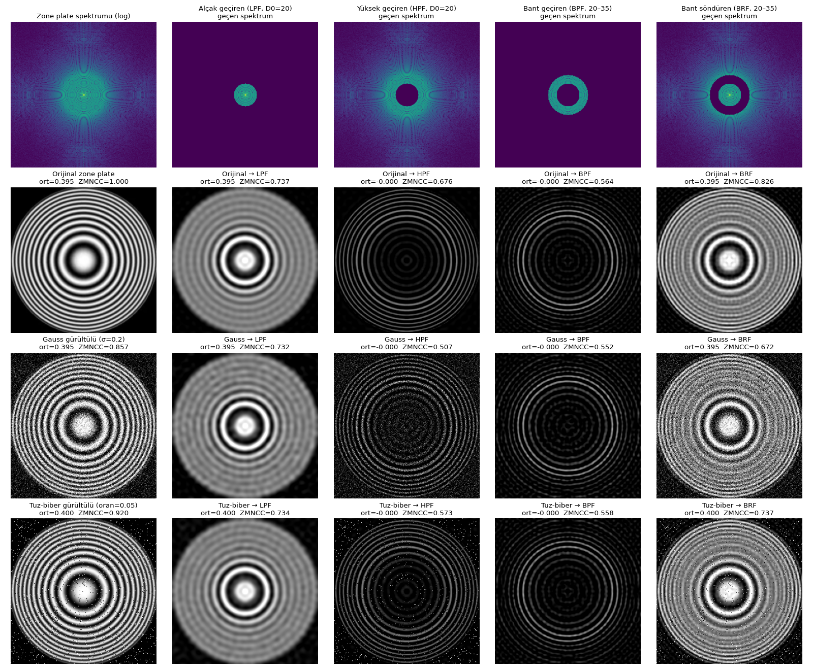
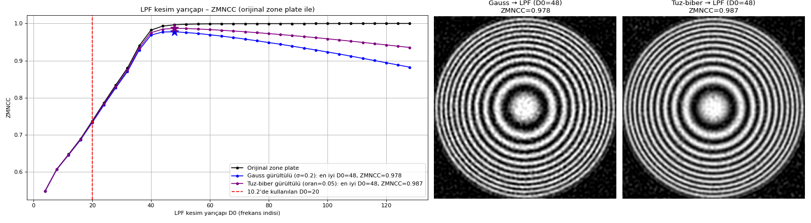
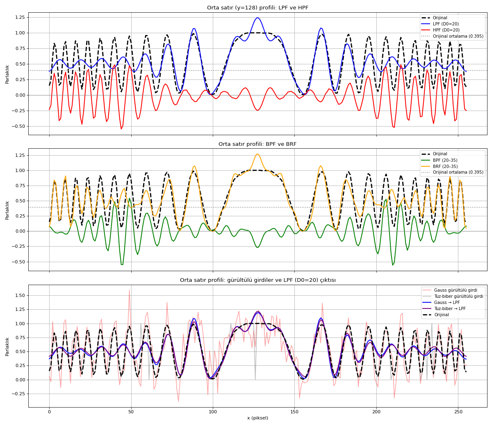

# Digital Image Processing — Week 7: Fourier Transform (DFT)

**Group members: Nmertgules and Iliya**

Sinüs sinyali üretme, gürültü ekleme ve gürültüyü temizleme; kendi yazdığımız 1B/2B DFT ve IDFT fonksiyonlarıyla frekans analizi ve frekans uzayında filtreleme. Son görev (Görev 10), ödevde verilen **zone plate** fotoğrafı üzerinde yapılır.

## Dosyalar

| Dosya | İçerik |
| --- | --- |
| [fft_odev.ipynb](fft_odev.ipynb) · [Colab](https://colab.research.google.com/github/iliyadindar/DEEP/blob/main/week7/fft_odev.ipynb) | Bütün görevler; açıklamalar Türkçe, çıktılarıyla kaydedildi |
| [fft_odev.html](fft_odev.html) | Notebook'un HTML çıktısı (`jupyter nbconvert --to html`) |
| [assets/zone_plate.png](assets/zone_plate.png) | Görev 10'un girdisi: verilen zone plate görseli, başlığı ve beyaz kenarları kırpılmış (390 × 390, gri) |
| [results/](results/) | Görev 10'un kaydettiği şekiller |

## Görevler

| Görev | Yapılan işlem |
| --- | --- |
| 1 | Genlik, frekans ve faz alan sinüs fonksiyonu; 512 (2⁹) elemanlı vektörü doldurup çizer |
| 2 | Vektöre genliğe ve [0, 1] gürültü oranına göre Gauss gürültüsü ekleyen fonksiyon |
| 3 | Gürültülü sinyal Gauss (σ = 3) ve medyan (pencere 15) filtreyle temizlenir |
| 4 | Kendi DFT fonksiyonumuz (2'nin kuvveti uzunluk kontrolü ile) harmonik vektörü döndürür; gürültüsüz ve gürültülü sinyalin spektrumu karşılaştırılır |
| 5 | 50 Hz / genlik 12 ve 30 Hz / genlik 5 gürültülü sinyallerin ayrı ayrı ve toplamlarının DFT analizi |
| 6 | Eşik değerin altındaki harmonikleri silen frekans filtresi; IDFT ile sinyal yeniden üretilir |
| 7 | Satır ve sütunlara 1B DFT uygulayan 2D DFT fonksiyonu; harmonik matris |
| 8 | Gauss ve tuz-biber gürültüsü ekleyen iki fonksiyon; harmonik matrisler orijinalle karşılaştırılır |
| 9 | 2D IDFT ile geri dönüş, ZMNCC ile ölçüm; piksel yakınlığı metrikleri (ZMNCC, MSE, PSNR, SSIM) raporu |
| 10 | Zone plate fotoğrafında ve gürültülü hallerinde ideal LPF, HPF, BPF ve BRF; gürültüye, kenar geçişlerine ve genel parlaklığa etkisinin yorumu |

Görev 7–9 yapay bir 64 × 64 sinüs deseni kullanır. Görev 10 ise verilen zone plate fotoğrafını kullanır: halkaları merkezden dışa doğru sıklaştığı için spektrumdaki her yarıçap görüntüde belirli bir halka bölgesine karşılık gelir ve bir filtrenin hangi frekansları geçirdiği, hangi halkaların kaldığı olarak doğrudan görülür.

## Çalıştırma

**Colab:** yukarıdaki Colab bağlantısını açıp *Çalışma zamanı → Tümünü çalıştır* (GPU gerekmez). Görev 10 fotoğrafı repoda bulamazsa GitHub'dan kendisi indirir.

**Kendi bilgisayarınızda:** `pip install -r week7/requirements.txt`, sonra notebook `week7` klasöründen (veya repo içindeki herhangi bir klasörden) çalıştırılır. Görev 10 şekillerini `week7/results/` altına yazar.

Kaydedilen çıktılar Windows 11 üzerinde Python 3.14, NumPy 2.3, SciPy 1.17, OpenCV 4.13 ve Matplotlib 3.10 ile üretildi. Görev 1–9'daki gürültü tohumsuz olduğu için her çalıştırmada biraz farklı çıkar; Görev 10'un tohumu sabittir (`np.random.seed(10)`), aşağıdaki sayılar her çalıştırmada aynıdır.

## Görev 10 sonuçları

Fotoğraf 2'nin kuvveti olan 256 × 256 boyuta `INTER_AREA` ile küçültüldü. DFT ve IDFT için Görev 9'daki kendi fonksiyonlarımız kullanıldı: 2D DFT, `np.fft.fft2` ile en fazla 2,4 · 10⁻¹⁰ farkla aynı sonucu verir. LPF + HPF ve BPF + BRF çıktılarının toplamı girdiyi 10⁻¹³ hatayla geri verir. Gürültü: Gauss σ = 0,2 ve tuz-biber, piksellerin %5'i.

| Filtre | Geçen spektrum | Ortalama parlaklık | ZMNCC (orijinal / Gauss / tuz-biber girdi) | Kalan gürültü RMS (Gauss / tuz-biber) | Kenar oranı |
| --- | --- | --- | --- | --- | --- |
| Filtresiz girdi | %100 | 0,395 | 1,000 / 0,857 / 0,920 | 0,200 / 0,136 | 1,00 |
| LPF, D0 = 20 | %1,9 | 0,395 | 0,737 / 0,732 / 0,734 | 0,027 / 0,023 | 0,27 |
| HPF, D0 = 20 | %98,1 | 0 | 0,676 / 0,507 / 0,573 | 0,198 / 0,134 | 0,91 |
| BPF, 20–35 | %4,0 | 0 | 0,564 / 0,552 / 0,558 | 0,039 / 0,028 | 0,70 |
| BRF, 20–35 | %96,0 | 0,395 | 0,826 / 0,672 / 0,737 | 0,196 / 0,133 | 0,70 |

*Kalan gürültü RMS*, `filtre(gürültülü) − filtre(orijinal)` farkıdır (filtre doğrusal olduğu için filtreden geçen gürültünün kendisi). *Kenar oranı*, orijinal girdide ortalama gradyan büyüklüğünün orijinalinkine oranıdır. Tuz-biber girdisinde LPF ve BRF'nin ortalaması 0,400'dür.

**Gürültü.** İki gürültü de beyazdır; ideal maske gürültü enerjisini spektrumda kapladığı alan oranında geçirir (LPF: 0,2 · √0,019 ≈ 0,028, ölçülen 0,027). D0 = 20 gürültüyü en çok bastırır ama ZMNCC'yi düşürür, çünkü plakanın ~58 pikselden dıştaki halkalarını da siler. LPF kesim taraması dengeyi gösterir: ZMNCC, D0 plakanın en yüksek frekansını (~43) geçtiği yerde tepe yapar (D0 = 48: Gauss 0,857 → 0,978, tuz-biber 0,920 → 0,987); daha büyük D0 yalnızca gürültü ekler. LPF tuz-biber darbelerini silmez, komşu piksellere yayar; darbe gürültüsü için medyan filtre daha uygundur.

**Kenar geçişleri.** LPF halkaları dıştan içe doğru siler (kenar oranı 0,27). HPF merkezdeki düz diski siler, dış halkaları ve keskin geçişleri korur (0,91), ama gürültüyü de geçirir. BPF yalnızca ~58–100 piksel arasındaki halka bandını bırakır; BRF tam bu bandı söndürür. İdeal maskeler çınlama (Gibbs) üretir: LPF çıktısının merkezi 1,00 yerine 1,24'e çıkar.

**Genel parlaklık.** Ortalama parlaklık DC katsayısıdır. LPF ve BRF onu geçirir, ortalama 0,395 kalır. HPF ve BPF onu siler: ortalama tam 0, piksellerin %50'si negatif olur ve görüntü aynı gri ölçekte koyu görünür.

